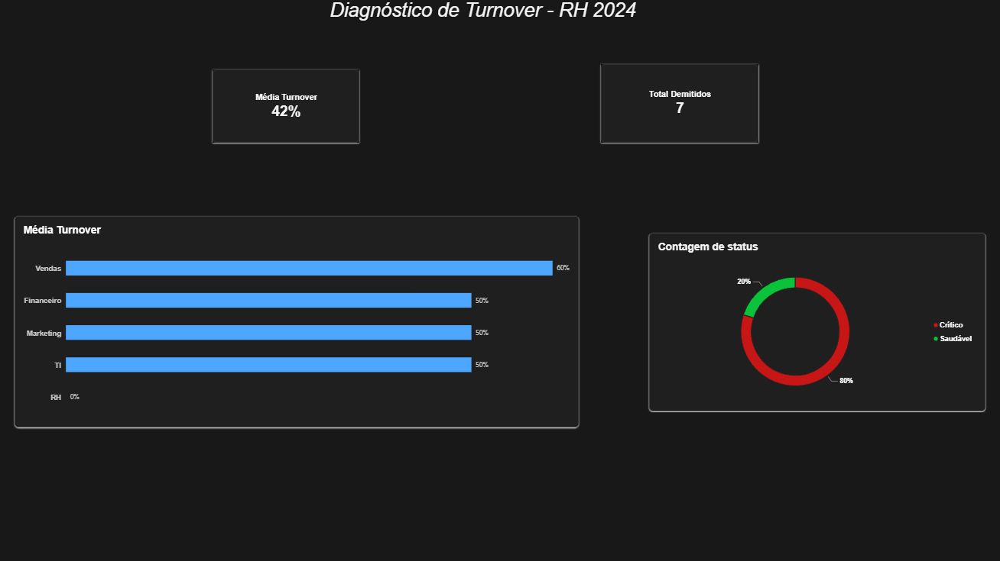

# Diagnóstico de Turnover de RH - Pipeline Completo (SQL + Excel + Power BI)

## Contexto e Problema de Negócio
A diretoria de uma empresa notou um aumento na rotatividade de funcionários (turnover) nos últimos meses e contratou a equipe de dados para investigar o problema. O objetivo deste projeto é identificar quais departamentos estão perdendo mais profissionais, se o tempo médio de casa é baixo e quais áreas exigem ação imediata de retenção.

## Ferramentas e Técnicas Utilizadas
- **SQL (PostgreSQL)**: Extração, modelagem relacional (JOINs), funções de agregação (COUNT, AVG) e tratamento de divisão por zero (NULLIF) para calcular a taxa de turnover.
- **Excel**: Importação de CSV, criação de regras de negócio (função SE) para classificar os departamentos em "Crítico" e "Saudável", e validação via Tabela Dinâmica.
- **Power BI**: Modelagem, criação de KPIs (Cartões) e visualização executiva (Gráfico de Barras e Rosca).

## Estrutura do Repositório
- `sql/`: Script de criação do banco e as queries de análise.
- `analise_rh.xlsx`: Planilha com o tratamento e a Tabela Dinâmica de validação.
- `turnover_dept.csv`: Base extraída do SQL.
- `imagens/`: Prints do dashboard final.

## Principais Insights e Conclusões
- **Departamento Crítico:** Vendas apresenta a maior taxa de turnover (**60%**), perdendo 3 de 5 funcionários.
- **Tempo Médio:** O tempo médio de casa dos funcionários que pediram demissão é de aproximadamente **497 dias** (cerca de 1 ano e 4 meses).
- **Insight de Gestão:** O departamento de RH não apresentou nenhuma demissão (0%), o que sugere que a equipe está estável. A ação imediata deve ser voltada para a equipe de Vendas, investigando se o problema é salarial, de metas ou de clima organizacional.

## Visualização do Dashboard

## Como Reproduzir
1. Clone o repositório.
2. Execute o script `sql/schema.sql` e `sql/seed.sql` no PostgreSQL.
3. Abra o arquivo `.pbix` no Power BI para visualizar o dashboard interativo.